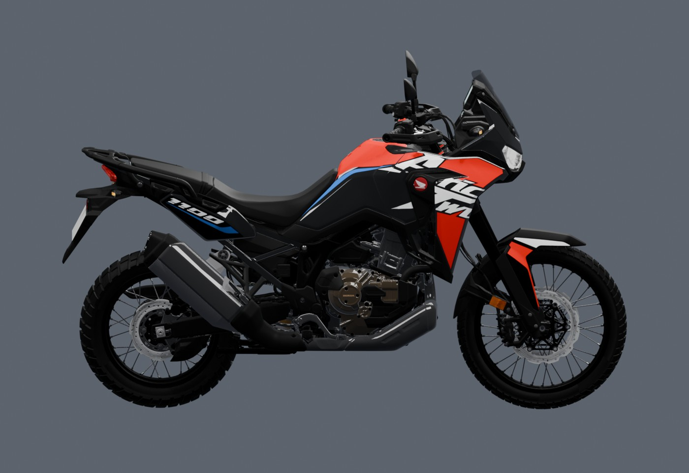
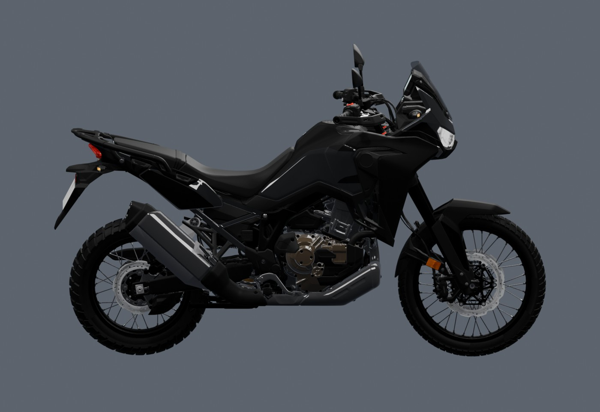
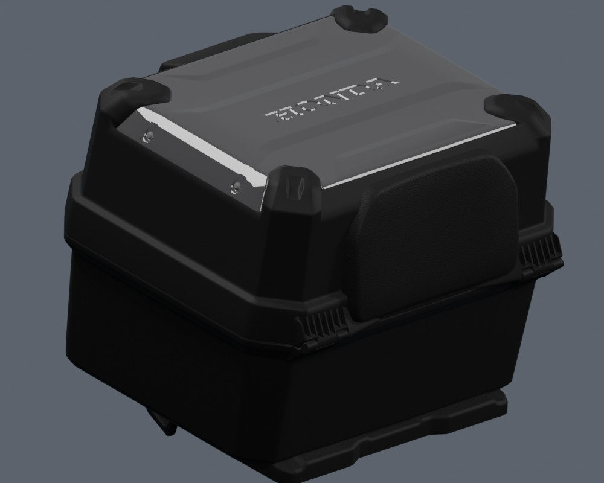
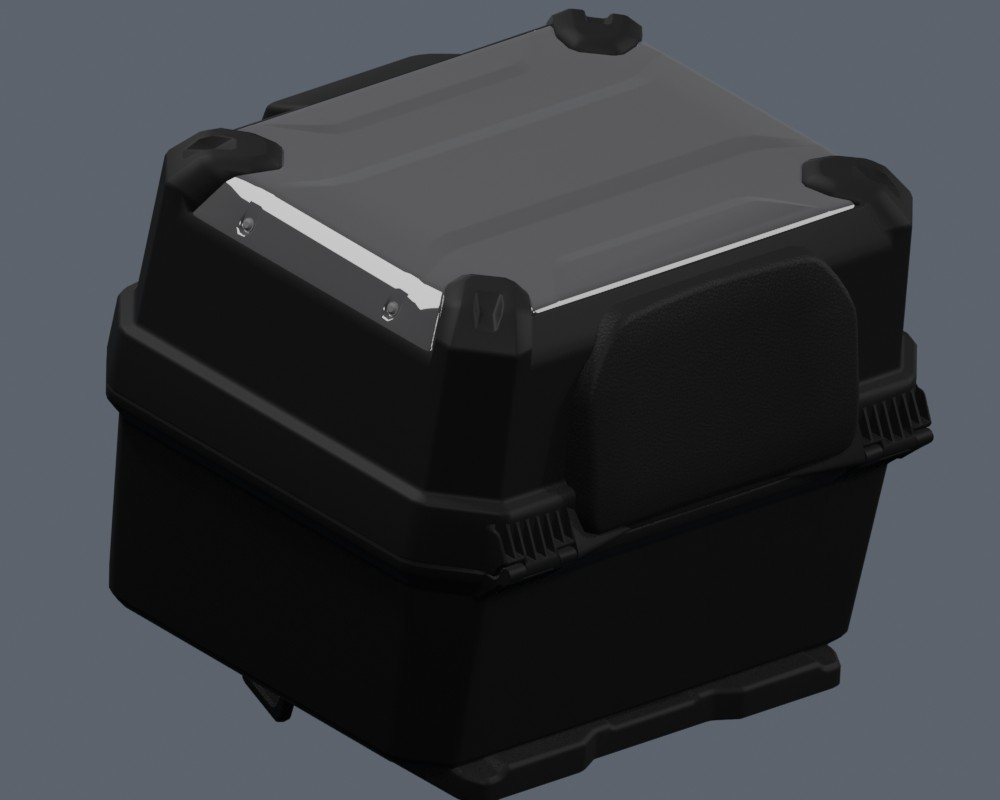
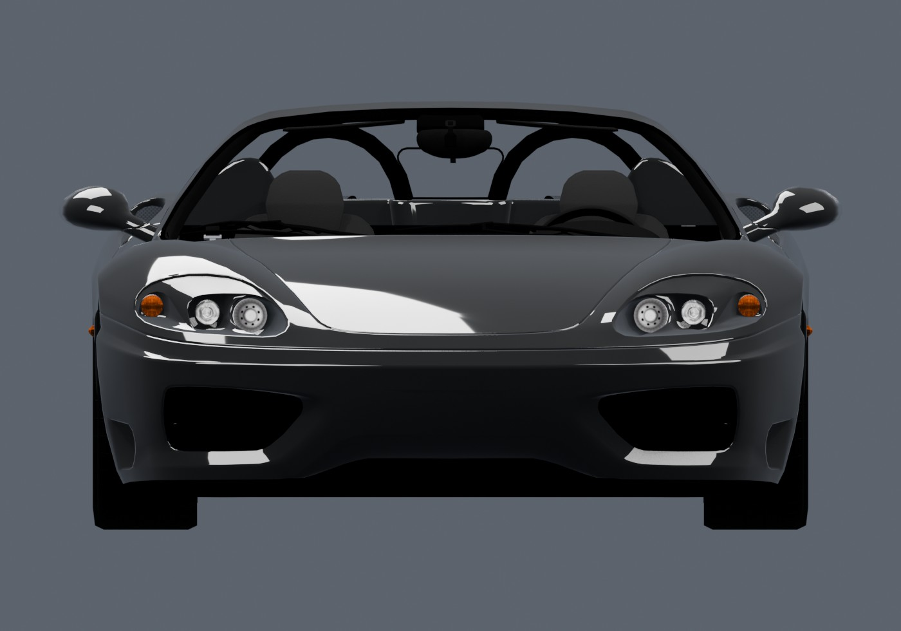

# GTA V / FiveM Brand Remover

A Codex skill for removing logos, badges, decals, and embossed branding from GTA V/FiveM vehicles while preserving geometry and original details, with visual verification in Blender and Sollumz.

Works with cars, motorcycles, and optional accessories in **YFT / YTD** packages. It guides Codex through inspecting the actual model, editing geometry and textures, reopening the final files, and producing review images. It is an assisted editing workflow, not an automatic one-click filter.

## Before and after

These are renders of real vehicle assets edited with the workflow. They are not AI-generated retouches. Vehicle models and texture archives are not included in this repository.

### Motorcycle — debranding and an explicitly requested solid finish

Honda emblems, Africa Twin/1100 graphics, engine-cover branding, luggage logos, exhaust branding, and separate stickers were addressed. The user chose a **solid black fairing**; changing the paint scheme is optional, not a default behavior.

| Before | After |
| --- | --- |
|  |  |

### Luggage — removing integrated raised lettering

The Honda lettering was part of the luggage lid's mesh. The affected surface was flattened and its local normals corrected while keeping the lid, ribs, edges, and hardware.

| Before | After |
| --- | --- |
|  |  |

### Car — removing the hood badge and its backing

Removing the badge alone can leave a raised black base. This revision removed the badge and its backing so the hood surface remained continuous. The complete vehicle audit also covered interior, engine, wheel, tire, and supplier branding.

| Before | After |
| --- | --- |
|  |  |

Paint, lighting, and missing generic GTA materials are approximated in the preview scenes. These examples were checked in Blender/Sollumz after reopening the saved binaries; they were not tested inside FiveM.

## What the skill covers

- **Mesh branding:** separate badges, 3D lettering, emblem backings, and relief integrated into a supporting surface.
- **Texture branding:** diffuse/color, alpha, normal/bump, specular, emissive, atlas variants, and mipmaps.
- **Grilles:** rebuild letter-shaped gaps using the original neighboring grille pattern, preserving open cells and depth.
- **Complete audits:** manufacturer and supplier logos, model names, stickers, small labels, tires, calipers, interior, engine, and accessories.
- **Preservation:** keep unrelated geometry, skin weights, bones, moving parts, glass, functional markings, tire tread, and material detail.
- **Appearance choices:** clarify uncertain graphic/stripe changes and confirm the color before applying a solid finish.
- **Evidence:** render the reopened final assets and describe exactly what was checked.

## Requirements

- Codex with local skill and file/tool access.
- Blender with Sollumz installed and enabled, plus the dependencies required by that Sollumz release.
- .NET 10 SDK for the bundled CodeWalker helpers. First use restores `CodeWalker.Core` 1.0.3 from NuGet.
- An archive extractor if the input is RAR/ZIP, and enough disk space for exported XML, DDS files, and review scenes.

The demonstrated environment used Windows, Blender 5.2.2 LTS, Sollumz 2.9.0, and szio 1.3.0.dev9. This records the tested setup; it does not guarantee every software/version combination. The skill does not bundle Blender, Sollumz, GTA game textures, or a remote execution service.

## Install

### Ask Codex to install it

Use the skill installer with this repository and the skill's subdirectory:

```text
Use $skill-installer to install gta-vehicle-debranding from
https://github.com/DanielDalPra/Skill-Brand-Remover-FIVEM
at skills/gta-vehicle-debranding.
```

### Manual installation on Windows

Clone the repository, then copy the skill folder into your Codex skills directory:

```powershell
git clone https://github.com/DanielDalPra/Skill-Brand-Remover-FIVEM.git
cd Skill-Brand-Remover-FIVEM
$skillRoot = if ($env:CODEX_HOME) {
    Join-Path $env:CODEX_HOME 'skills'
} else {
    Join-Path $env:USERPROFILE '.codex/skills'
}
New-Item -ItemType Directory -Force -Path $skillRoot | Out-Null
Copy-Item -LiteralPath './skills/gta-vehicle-debranding' -Destination $skillRoot -Recurse
```

If the skill is already installed, back up your customized copy before replacing it. On other platforms, copy the same folder to `$CODEX_HOME/skills` or `~/.codex/skills`. Start a new Codex chat if the skill does not appear in the current list.

## How to use

Attach the vehicle archive or provide its local path. Specify whether you want every brand removed or only a particular mark/region. Keep any previously approved reference images available.

**Remove all branding while retaining the finish:**

```text
Use $gta-vehicle-debranding on this vehicle archive.
Remove all visible brands, including suppliers, stickers, interior,
engine, wheels, tires, and optional accessories. Preserve the paint
and original details. Ask me if a visual choice is unclear.
Return the edited stream folder and before/after review images.
```

**Keep a grille open:**

```text
Use $gta-vehicle-debranding to remove the lettering from this grille.
Rebuild the center using its original perforated pattern.
Keep the frame, ribs, thickness, and actual openings.
```

**Motorcycle with a solid finish:**

```text
Use $gta-vehicle-debranding on this motorcycle.
Remove logos, model names, and stickers, including luggage and exhaust.
Make the fairings solid black. Preserve the seat, tire tread, lights,
reflectors, metal parts, and functional dashboard markings.
```

Publishing or uploading the result is a separate action: specify the destination when you want it. The skill does not automatically send vehicle files to Drive or publish them.

## Workflow and output

1. Preserve the original archive and inventory every model, accessory, LOD, and texture dictionary.
2. Inspect materials, atlases, alpha, relief, and connected mesh components.
3. Clarify uncertain appearance choices, then edit only the requested areas.
4. Rebuild and reopen the final binaries. Check geometry, textures, and preserved mechanical data.
5. Render front/rear, both sides, changed-area closeups, and relevant accessory/interior views.
6. Package `stream/`, replacement instructions, and matching review images.

Typical delivery:

```text
vehicle-delivery/
├── stream/              # Final YFT/YTD files, including affected accessories
├── review/              # Images from the saved final assets
└── instructions.txt     # Replacement steps and verification limits
```

Do not place Blender projects, XML intermediates, or temporary preview materials inside the streaming folder. After replacing assets, test the vehicle and its accessories in the target FiveM resource.

## Included helpers

| Helper | Purpose |
| --- | --- |
| `scripts/codewalker-convert` | YFT ↔ CodeWalker XML, with output reopening and overwrite protection. |
| `scripts/codewalker-textures` | Export YTD/DDS and selectively patch changed DDS payloads while preserving all dictionary entries. |
| `scripts/blender_review.py` | Import through Sollumz, generate preview wheel instances where appropriate, and create separate editing/review scenes. |

Paths above are relative to `skills/gta-vehicle-debranding/`. See [tool setup and commands](skills/gta-vehicle-debranding/references/local-workflow.md) for usage. Output parent directories must exist; choose a new revision path rather than overwriting review files.

The texture helper expects edited DDS files to retain their original exported headers and payload sizes. It does not resize textures or change their compression. Unsupported DDS exports must not cause their original dictionary entries to be discarded.

## Troubleshooting and limits

| Symptom | What to inspect |
| --- | --- |
| Letters remain after recoloring | Geometry, normal/bump, specular, emissive, atlas variants, and lower mip levels. |
| A black square remains on the hood | The badge backing may use another material. |
| A grille becomes a solid slab | Rebuild native open cells; verify from an oblique angle. |
| A logo returns after changing accessories | Inspect every optional YFT and alternate livery. |
| Blender still shows the old texture | Reload/reimport the final YTD export; previously packed images may be stale. |
| Missing materials or only a reference wheel | Check resolved image paths and the preview helper's report; generated wheel instances belong only in the review scene. |
| Binary reopens but the game fails | Review export warnings, glass/shattermap data, resource configuration, and actual in-game behavior. A render is not an in-game test. |

Some models require manual topology reconstruction. The skill does not promise universal compatibility or prove the absence of every logo from a single screenshot. It reports inspected regions and unverified areas, and keeps generic-material substitutions confined to the preview scene.

## Repository layout

```text
skills/gta-vehicle-debranding/
├── SKILL.md
├── agents/openai.yaml
├── references/
│   ├── local-workflow.md
│   ├── full-brand-audit.md
│   └── raptor-lessons.md
└── scripts/
    ├── blender_review.py
    ├── codewalker-convert/
    └── codewalker-textures/
docs/examples/           # Real before/after renders
```

When contributing, keep new rules grounded in demonstrated editing problems. Avoid vehicle-specific indices, personal paths, generated build files, and proprietary model archives. Use a new workspace to validate changes before publishing.
